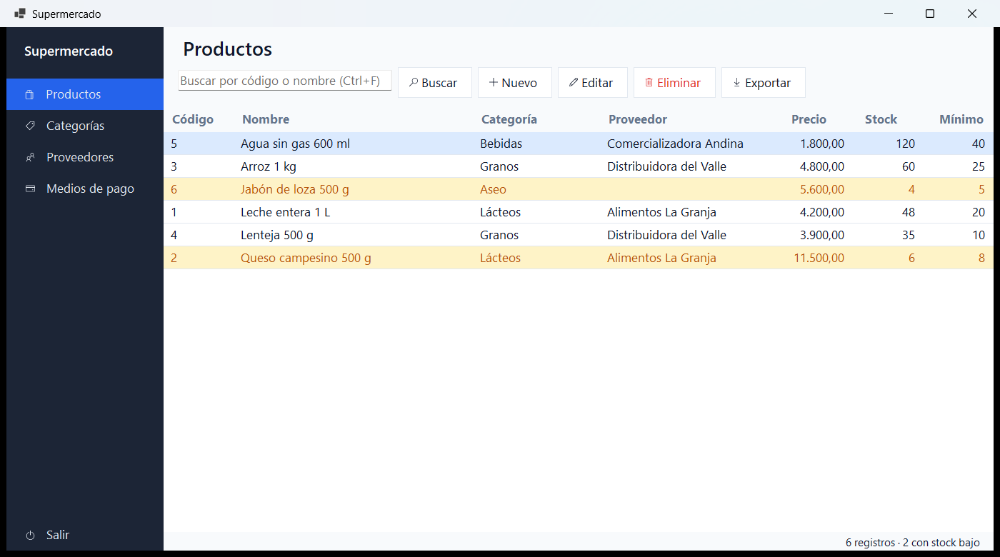
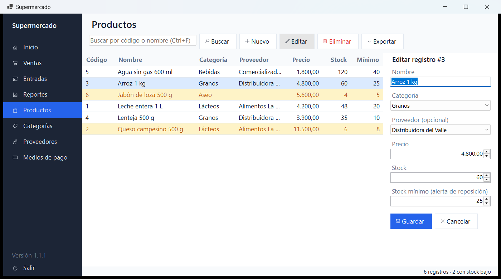
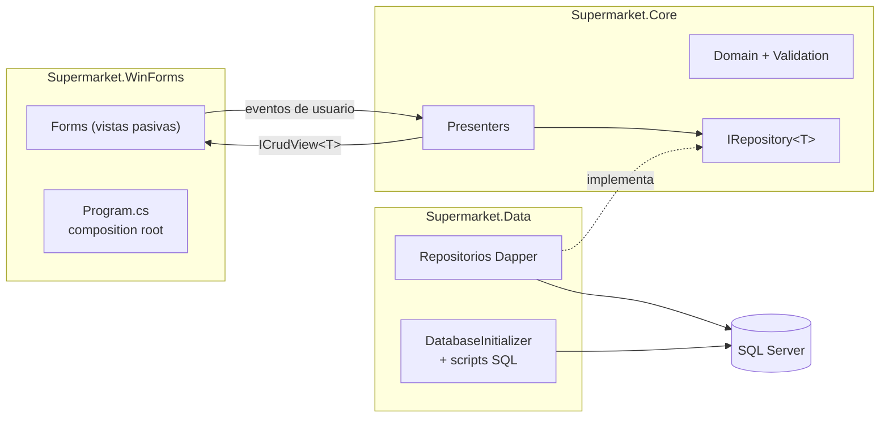

# Supermarket

Aplicación de escritorio para operar un supermercado: registro de ventas con control de inventario, y administración de productos, categorías, proveedores y medios de pago.

Construida con **.NET 10**, **Windows Forms** y **SQL Server**, siguiendo el patrón **Model-View-Presenter (Passive View)**.



## Funcionalidades

- **Ventas:** carrito con validación de stock, medio de pago y total. Al registrar, la venta se guarda en una transacción y el stock se descuenta de forma atómica. Incluye el historial de ventas recientes con el detalle de cada una.
- CRUD completo de productos, categorías, proveedores y medios de pago.
- Búsqueda por código o por nombre parcial. En productos también busca por categoría y por proveedor.
- Cada producto puede tener un proveedor habitual. Un proveedor o una categoría en uso no se puede eliminar.
- Ordenamiento haciendo clic en los encabezados de la tabla. El orden se mantiene al refrescar la lista.
- Exportación a CSV de lo que muestra la tabla, lista para abrir en Excel: UTF-8, separador de la configuración regional y protección contra inyección de fórmulas.
- Stock mínimo por producto: los productos que necesitan reposición se resaltan, y la barra de estado indica cuántos son.
- Validación en dos niveles: reglas de dominio con Data Annotations y restricciones en la base de datos (`UNIQUE`, `CHECK`, `FOREIGN KEY`).
- Mensajes claros para errores esperados: nombres duplicados, registros en uso o registros eliminados por otro usuario.
- Base de datos creada y migrada automáticamente al iniciar, con datos de ejemplo opcionales.
- Atajos de teclado: `Ctrl+N` nuevo, `Ctrl+F` buscar, `Enter` editar, `Supr` eliminar, `Esc` cancelar. En ventas, `Enter` en la cantidad agrega el producto y `F9` registra la venta.



## Arquitectura



| Proyecto | Responsabilidad | Depende de |
| --- | --- | --- |
| `Supermarket.Core` | Entidades, validación, contratos de repositorio y presentadores. No conoce WinForms ni SQL Server. | — |
| `Supermarket.Data` | Repositorios con Dapper, traducción de errores de SQL Server y creación del esquema. | Core |
| `Supermarket.WinForms` | Vistas, navegación, configuración e inyección de dependencias. | Core, Data |

### Decisiones técnicas

- **Presentadores sin UI.** Las vistas implementan `ICrudView<T>`, solo exponen eventos y métodos de renderizado, y no contienen lógica. Esto permite probar todo el flujo (cargar, buscar, crear, editar, eliminar y manejar errores) con dobles de prueba.
- **Un presentador genérico.** `CrudPresenter<T>` implementa el flujo una sola vez. `CatalogPresenter<T>` y `ProductPresenter` solo agregan lo que es propio de cada uno, en lugar de duplicar cuatro presentadores casi idénticos. `PresenterBase` centraliza el estado de "ocupado" y el manejo de errores que comparten el CRUD y las ventas.
- **Ventas sin sobreventa.** El stock se descuenta con un `UPDATE ... WHERE Stock >= @Quantity` dentro de una transacción. Si un producto no alcanza, se revierte toda la venta. Una prueba de integración lanza cinco ventas simultáneas por la última unidad y verifica que solo una se registre. Los productos se bloquean siempre en el mismo orden para evitar deadlocks.
- **El precio lo pone el servidor.** El cliente solo envía producto y cantidad. El precio unitario se toma de la base al momento de vender y queda guardado en la línea, así que un cambio de precio posterior no altera las ventas pasadas.
- **Excepciones de dominio.** Los repositorios convierten los errores 547, 2601 y 2627 de SQL Server en `DataConflictException`, y las filas afectadas = 0 en `EntityNotFoundException`. Los presentadores nunca dependen del proveedor de base de datos.
- **SQL seguro.** Todos los valores viajan como parámetros. Los comodines de `LIKE` (`%`, `_`, `[`) se escapan para que buscar "50%" encuentre exactamente eso.
- **Esquema versionado.** Los scripts `schema.sql` y `seed.sql` son idempotentes, van embebidos en el ensamblado y son los mismos que usan la aplicación y las pruebas de integración. Los cambios de esquema se agregan como pasos que actualizan bases existentes (`MinimumStock`, `ProviderId`, tablas de ventas), y una prueba de integración parte de una base con el esquema original y verifica la actualización.
- **Async de punta a punta**, con protección contra dobles clics mientras hay una operación en curso.
- **Calidad en la compilación:** `TreatWarningsAsErrors`, analizadores .NET (`latest-recommended`), estilo de código verificado en el build, gestión central de paquetes y auditoría de vulnerabilidades de NuGet.

## Requisitos

- Windows 10 u 11
- [.NET SDK 10](https://dotnet.microsoft.com/download/dotnet/10.0)
- SQL Server. Cualquiera de estas opciones:
  - **LocalDB**, que viene con Visual Studio. Es la configuración por defecto.
  - **Docker**, con el `docker-compose.yml` incluido.

## Cómo ejecutar

```bash
git clone https://github.com/zemogc/Trabajo-Li-z.git
cd Trabajo-Li-z
dotnet run --project src/Supermarket.WinForms
```

Al iniciar, la aplicación crea la base de datos `Supermarket`, aplica el esquema y carga datos de ejemplo. Ese comportamiento se controla desde la sección `Database` de `appsettings.json`.

### Usar SQL Server en Docker

```bash
docker compose up -d --wait
```

El contenedor solo escucha en `127.0.0.1`. La contraseña de `sa` es una contraseña de desarrollo; para usar otra, define la variable `MSSQL_SA_PASSWORD` (o un archivo `.env`, que Git ignora) antes de levantarlo.

Crea `src/Supermarket.WinForms/appsettings.Local.json`. Git lo ignora, así que no se sube al repositorio.

```json
{
  "ConnectionStrings": {
    "Supermarket": "Server=localhost,14333;Database=Supermarket;User Id=sa;Password=Dev_Passw0rd!;TrustServerCertificate=true"
  }
}
```

## Verificación local

`build.ps1` ejecuta los mismos controles que correría un servidor de integración continua, pero en tu máquina:

```powershell
./build.ps1                    # formato, build Release, pruebas y reporte de cobertura
./build.ps1 -SkipIntegration   # sin Docker
```

Si Docker no está corriendo, el script omite las pruebas de integración y lo indica. El reporte de cobertura queda en `artifacts/coverage/index.html`.

## Pruebas

```bash
# Pruebas unitarias de dominio y presentadores (rápidas, sin dependencias externas)
dotnet test tests/Supermarket.Core.Tests

# Pruebas de la capa WinForms: ordenamiento, exportación CSV y renderizado de pantallas
dotnet test tests/Supermarket.WinForms.Tests

# Pruebas de integración contra un SQL Server real (requiere Docker)
dotnet test tests/Supermarket.Data.IntegrationTests
```

Cobertura de líneas medida con `build.ps1`:

| Capa | Cobertura |
| --- | --- |
| `Supermarket.Core` | 94 % |
| `Supermarket.Data` | 96 % |
| `Supermarket.WinForms` | 65 % |

La lógica vive en `Core` y `Data`, que están cubiertos casi por completo. En la capa WinForms, además de probar sus componentes no visuales, hay pruebas de humo que construyen cada pantalla fuera de pantalla, le pasan datos por su interfaz de vista y la dibujan a una imagen, sin abrir ninguna ventana. Las rutas de arranque y los diálogos se prueban manualmente.

Las pruebas de integración usan [Testcontainers](https://dotnet.testcontainers.org/) para levantar un SQL Server 2022 desechable. Validan los repositorios, las restricciones de la base de datos y el inicializador contra el motor real, no contra un simulador en memoria.

## Estructura

```
├── src
│   ├── Supermarket.Core          # Dominio, validación, contratos y presentadores
│   ├── Supermarket.Data          # Repositorios SQL Server y scripts del esquema
│   └── Supermarket.WinForms      # Vistas y composition root
├── tests
│   ├── Supermarket.Core.Tests                 # xUnit, sin base de datos
│   ├── Supermarket.WinForms.Tests             # Ordenamiento, CSV y renderizado de pantallas
│   └── Supermarket.Data.IntegrationTests      # xUnit + Testcontainers
├── build.ps1                     # Verificación local: formato, build y pruebas
├── Directory.Build.props         # Configuración común de compilación y análisis
├── Directory.Packages.props      # Versiones centralizadas de NuGet
└── docker-compose.yml            # SQL Server local para desarrollo
```

## Origen

El proyecto nació como un parcial universitario de la materia de Lenguajes de Programación: un CRUD en un solo proyecto WinForms sobre .NET 7. Después se reestructuró por completo con la arquitectura, las pruebas y las prácticas descritas arriba.
